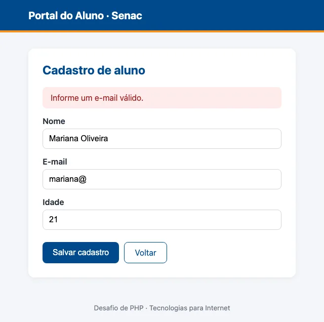
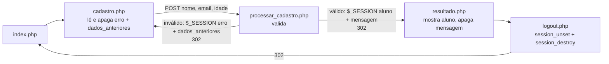

# Portal do Aluno (PHP)

Cadastro de aluno em PHP puro com validação no servidor, sessão, mensagem flash e logout. Desafio da Noite (29/10) da disciplina **Tecnologias para Internet** (ADS, Senac São José dos Pinhais).

| Erro de validação, com os campos preservados | Cadastro salvo na sessão |
|---|---|
|  |  |

Dados fictícios, prints feitos com `php -S`.

## O que foi pedido e o que foi feito

O professor entregou um projeto incompleto: arquivos com nomes trocados fora das pastas e 26 `TODO`s no código. O enunciado completo está em [`docs/ENUNCIADO.md`](docs/ENUNCIADO.md). A entrega:

- reorganiza os arquivos na estrutura pedida (`portal_aluno/` + `includes/`);
- completa os `TODO`s: `session_start`, `filter_input` com `FILTER_VALIDATE_EMAIL`/`FILTER_VALIDATE_INT`, `header("Location")` + `exit`, `include`/`require_once`;
- valida nome obrigatório, e-mail válido e idade inteira maior que zero;
- devolve o erro e os valores digitados para o formulário;
- mostra a mensagem de sucesso uma vez só (flash message) e mantém o aluno na sessão;
- escapa tudo na exibição com `htmlspecialchars(..., ENT_QUOTES, "UTF-8")` (função `escapar()`);
- bônus: `limparTexto()` trata o nome antes da validação.

## Como funciona



GET direto em `processar_cadastro.php` redireciona para `cadastro.php` sem processar nada.

## Como rodar

Pré-requisito: PHP 8 (sem banco de dados, sem dependências).

```bash
cd portal_aluno
php -S localhost:8000
# http://localhost:8000
```

No XAMPP: copie `portal_aluno/` para o `htdocs`, ligue o Apache e abra `http://localhost/portal_aluno/`.

## Estrutura

```text
portal_aluno/
├── index.php                 página inicial
├── cadastro.php              formulário
├── processar_cadastro.php    recebe o POST e valida
├── resultado.php             mostra o aluno da sessão
├── logout.php                encerra a sessão
├── TESTES.md                 bateria de testes e respostas
└── includes/
    ├── cabecalho.php         HTML inicial + CSS
    ├── rodape.php
    └── funcoes.php           validarEmail, limparTexto, escapar
docs/ENUNCIADO.md             enunciado original do desafio
```

## Testes

Os 9 cenários do enunciado (mais dois extras) passaram e estão registrados em [`portal_aluno/TESTES.md`](portal_aluno/TESTES.md), junto com as respostas das perguntas do desafio. Para checar a sintaxe: `for f in portal_aluno/*.php portal_aluno/includes/*.php; do php -l "$f"; done`.
